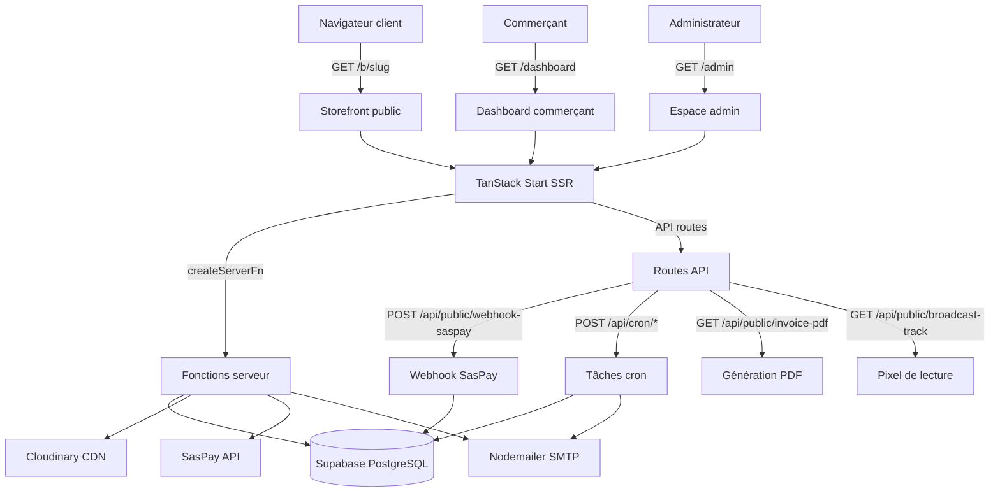

# 01 — Architecture technique

> Dernière mise à jour : 2026-10-21
> Source : `package.json`, `vite.config.ts`, `vercel.json`, `src/router.tsx`, `src/server.ts`

---

## Pile technique

| Couche | Technologie | Version |
|---|---|---|
| Framework UI | React | 19.x |
| Framework full-stack | TanStack Start (Vite + Nitro) | 1.168.x |
| Routeur | TanStack Router | 1.170.x |
| État serveur | TanStack Query | 5.x |
| Base de données | Supabase (PostgreSQL) | supabase-js 2.x |
| Styles | Tailwind CSS v4 | 4.2.x |
| Composants UI | Radix UI (via shadcn/ui) | voir package.json |
| Formulaires | React Hook Form + Zod | 7.x / 3.x |
| Images | Cloudinary | 2.x |
| E-mails | Nodemailer (SMTP) | 10.x |
| PDF | pdf-lib | 1.x |
| Paiement | SasPay (API REST propriétaire) | — |
| Hébergement | Vercel (preset Nitro) | — |
| ORM scripts | Drizzle Kit (migrations uniquement) | 0.x |
| Runtime scripts | Node.js / Bun | — |
| Tests | Vitest | 4.x |

---

## Diagramme d'architecture

---

## Multi-boutiques (multi-tenant)

- Chaque commerçant possède **exactement une boutique** (`shops.owner_id` unique).
- L'isolation est assurée par la colonne `shop_id` sur chaque table relationnelle.
- La **Row Level Security (RLS)** PostgreSQL garantit qu'un commerçant ne peut pas accéder aux données d'un autre.
- La fonction `is_shop_owner(_shop_id)` vérifie la propriété dans toutes les politiques RLS.

---

## URLs de boutique

- Format : `/b/{slug}` (exemple : `/b/boutique-kinshasa`)
- Le slug est **unique** et modifiable **une seule fois** par le commerçant.
- Après modification, `shops.slug_changed = true` bloque tout changement ultérieur (sauf admin).
- Prévu pour l'extension vers sous-domaine ou domaine personnalisé (non implémenté).

---

## Fonctions serveur (createServerFn)

Les fonctions métier sont définies avec `createServerFn` de TanStack Start. Elles s'exécutent **exclusivement côté serveur** et sont appelées depuis les composants React comme des fonctions async normales.

Fichiers principaux :
- `src/lib/subscriptions.functions.ts` — abonnements, paiements, checkout SasPay
- `src/lib/support.functions.ts` — tickets, diffusions, broadcasts
- `src/lib/account-deletion.functions.ts` — workflow suppression de compte
- `src/lib/storefront.functions.ts` — données boutique publique
- `src/lib/admin.functions.ts` — actions admin (suppression, notifications)
- `src/lib/cloudinary.functions.ts` — signature d'upload

---

## Routes API HTTP

| Méthode | Route | Rôle |
|---|---|---|
| POST | `/api/public/webhook-saspay` | Réception des événements SasPay (paiements) |
| GET | `/api/public/invoice-pdf` | Génération PDF de facture ou lettre d'attribution |
| GET | `/api/public/broadcast-track` | Pixel de lecture pour les diffusions e-mail |
| GET | `/api/public/media/*` | Proxy d'images privées Supabase Storage |
| POST | `/api/cron/process-account-deletions` | Rappels J-7 et suppressions définitives |
| POST | `/api/cron/subscription-reminders` | Rappels d'expiration d'abonnement |

---

## Hébergement et build

- **Hébergement** : Vercel
- **Preset build** : `NITRO_PRESET=vercel vite build` (source : `vercel.json`)
- **Pré-build** : `node scripts/deploy-prebuild.mjs` (migrations SQL + création admin)
- **Port local** : `http://localhost:8080`
- **Configuration Vercel** : `vercel.json` à la racine

---

## Stockage des médias

Deux systèmes coexistent :
1. **Cloudinary** : images produits optimisées (WebP, redimensionnement automatique). Accès via URL publique Cloudinary.
2. **Supabase Storage** (`shop-media`) : ancienne méthode. Accès via proxy `/api/public/media/*`. Un script de migration vers Cloudinary existe : `scripts/migrate-supabase-media-to-cloudinary.mjs`.
