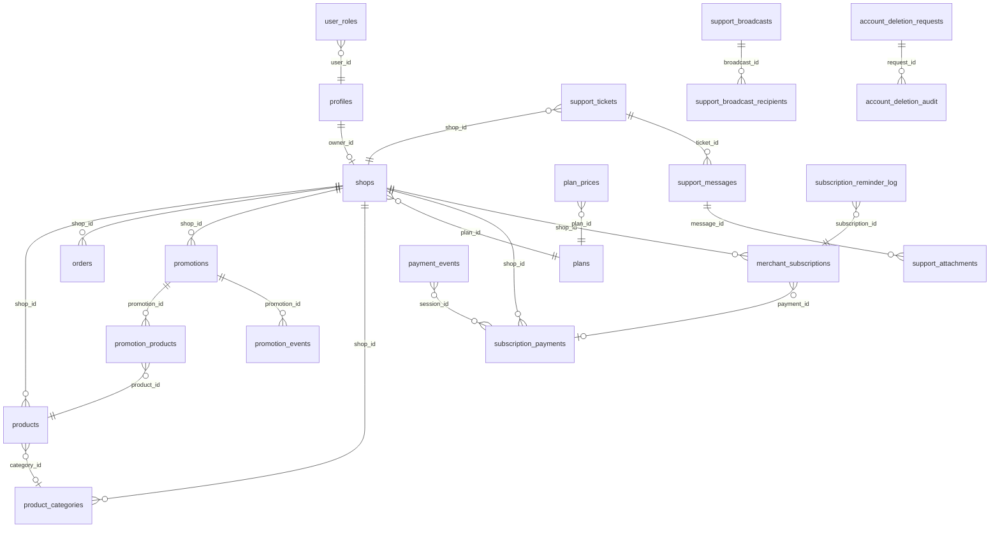

# 02 — Base de données

> Dernière mise à jour : 2026-10-21
> Source : `supabase/migrations/` (20 fichiers)

---

## Vue par domaine

### Utilisateurs et rôles
| Table | Description | Migration |
|---|---|---|
| `profiles` | Profil utilisateur (nom, email, statut) | `20261009000000` |
| `user_roles` | Rôle attribué (admin ou merchant) | `20261009000000` |

### Boutiques
| Table | Description | Migration |
|---|---|---|
| `shops` | Boutique commerçant (slug, thème, WhatsApp…) | `20261009000000` |
| `product_categories` | Catégories personnalisées par boutique | `20261009000000` |

### Produits et commandes
| Table | Description | Migration |
|---|---|---|
| `products` | Produits (prix, images[], variantes jsonb) | `20261009000000` |
| `orders` | Commandes WhatsApp (items jsonb, total) | `20261009000000` |

### Plans et abonnements
| Table | Description | Migration |
|---|---|---|
| `plans` | Plans disponibles (free, pro, business) | `20261009000002` |
| `plan_prices` | Tarifs en CDF (mensuel/annuel) synchronisés par trigger | `20261014000000` |
| `subscription_payments` | Historique des paiements SasPay et manuels | `20261009000002` + `20261014000000` |
| `merchant_subscriptions` | Abonnements actifs (début, fin, statut) | `20261014000000` |
| `payment_events` | Journal brut des webhooks reçus | `20261014000000` |

### Promotions
| Table | Description | Migration |
|---|---|---|
| `promotions` | Campagnes promotionnelles (titre, template, dates) | `20261009000004` |
| `promotion_products` | Produits liés à une promotion (max 24) | `20261009000004` |
| `promotion_events` | Événements de promotion (view, click, share…) | `20261009000004` |

### Support
| Table | Description | Migration |
|---|---|---|
| `support_tickets` | Tickets d'assistance (numéro T-XXXX, statut) | `20261015000001` |
| `support_messages` | Messages dans un ticket | `20261015000001` |
| `support_attachments` | Images jointes aux messages | `20261015000001` |
| `notification_outbox` | Suivi des e-mails envoyés | `20261015000001` |
| `subscription_reminder_log` | Déduplication des rappels d'abonnement | `20261015000001` |

### Diffusions (Broadcasts)
| Table | Description | Migration |
|---|---|---|
| `support_broadcasts` | Annonces créées par l'admin | `20261017000001` |
| `support_broadcast_recipients` | Destinataires individuels avec suivi de lecture | `20261017000001` |

### Suppression de compte
| Table | Description | Migration |
|---|---|---|
| `account_deletion_requests` | Demandes de suppression soumises | `20261020000000` |
| `account_deletion_audit` | Journal d'audit du workflow de suppression | `20261020000000` |

### Paramètres et administration
| Table | Description | Migration |
|---|---|---|
| `app_settings` | Paramètres globaux clé/valeur (jsonb) | `20261009000002` |
| `audit_log` | Journal d'actions admin | `20261009000002` |
| `shop_reports` | Signalements de boutiques | `20261009000002` |

### Supprimées
| Table | Raison | Migration |
|---|---|---|
| `meta_connections` | Module Meta/Facebook abandonné | `20261017000000` |
| `meta_posts` | Module Meta/Facebook abandonné | `20261017000000` |

---

## Relations principales (Mermaid)

---

## Colonnes importantes

### `shops`
| Colonne | Type | Description |
|---|---|---|
| `slug` | text unique | URL de la boutique — modifiable une seule fois |
| `slug_changed` | boolean | Verrou : true = slug déjà modifié |
| `whatsapp` | text | Format international `+243...` obligatoire |
| `theme` | text | Thème CSS : savane, minuit, boutique, marche, pur, oasis |
| `primary_color` | text | Couleur principale en hexadécimal |
| `currency` | text | USD ou CDF pour les produits |
| `is_published` | boolean | Visible en public |
| `is_suspended` | boolean | Suspendu par admin |
| `account_status` | text | active ou suspended_for_deletion |
| `plan_id` | text | Référence vers `plans.id` |
| `plan_expires_at` | timestamptz | Date d'expiration du plan payant |
| `views` | integer | Compteur de vues (via `increment_shop_view`) |

### `products`
| Colonne | Type | Description |
|---|---|---|
| `images` | text[] | URLs des photos (Cloudinary ou proxy Supabase) |
| `variants` | jsonb | Tableau de variantes `{name, values[]}` |
| `status` | enum | active, hidden, out_of_stock |
| `featured` | boolean | Mis en avant sur la vitrine |
| `price` | numeric(12,2) | Prix (>= 0) |

### `subscription_payments`
| Colonne | Type | Description |
|---|---|---|
| `montant_cdf` | numeric(12,2) | Montant en FC |
| `statut` | text | en_attente, payé, échoué, à_vérifier |
| `methode` | text | saspay ou manuel |
| `saspay_session_id` | text | Identifiant de session SasPay |
| `saspay_transaction_id` | text | Identifiant de transaction confirmée |
| `montant_debite` | numeric | Montant réellement débité (avec frais) |

---

## RLS résumée par table

| Table | anon | authenticated | Règle clé |
|---|---|---|---|
| `shops` | SELECT (publiées, non suspendues, actives) | SELECT/INSERT/UPDATE/DELETE | owner ou admin |
| `products` | SELECT (status != hidden, boutique publique) | CRUD | owner ou admin |
| `orders` | INSERT seulement | SELECT/UPDATE | owner ou admin |
| `promotions` | SELECT (publiées, actives) | CRUD | owner ou admin |
| `plans` | SELECT | admin CRUD | public en lecture |
| `plan_prices` | SELECT | admin CRUD | public en lecture |
| `subscription_payments` | — | SELECT (own), UPDATE (admin) | pas d'anon |
| `merchant_subscriptions` | — | SELECT (own ou admin) | pas d'anon |
| `payment_events` | — | SELECT (admin seulement) | très restreint |
| `support_tickets` | — | SELECT/INSERT/UPDATE (own ou admin) | pas d'anon |
| `support_broadcasts` | — | admin CRUD + merchant SELECT (destinataires) | pas d'anon |
| `account_deletion_requests` | — | merchant INSERT/SELECT/UPDATE, admin all | pas d'anon |
| `audit_log` | — | SELECT/INSERT (admin) | très restreint |
| `app_settings` | SELECT | admin CRUD | public en lecture |
| `user_roles` | — | SELECT (own ou admin) | pas d'anon |

---

## Types énumérés

| Type | Valeurs |
|---|---|
| `app_role` | admin, merchant |
| `product_status` | active, hidden, out_of_stock |
| `order_status` | new, confirmed, delivered, cancelled |
| `payment_status` (ancienne) | pending, approved, rejected |

---

## Triggers importants

| Trigger | Table | Fonction | Rôle |
|---|---|---|---|
| `on_auth_user_created` | `auth.users` | `handle_new_user()` | Crée profil + rôle merchant à l'inscription |
| `shops_guard` | `shops` | `shop_slug_guard()` | Verrou slug, vues, account_status |
| `shops_plan_guard` | `shops` | `shop_plan_guard()` | Empêche modification de plan côté client |
| `products_limit` | `products` | `product_limit_guard()` | Bloque dépassement quota produits/photos |
| `promotions_guard` | `promotions` | `promotion_guard()` | Vérifie quota promos actives et templates autorisés |
| `trg_sync_plan_prices` | `plans` | `sync_plan_prices_from_plans()` | Synchronise `plan_prices` en CDF |
| `trg_support_messages_after_insert` | `support_messages` | Trigger | Mise à jour `dernier_message_le` + réouverture ticket |
