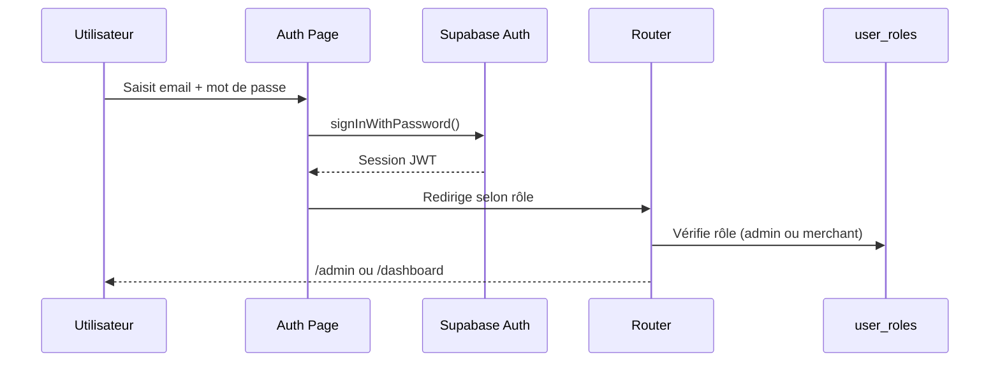

# 03 — Sécurité et rôles

> Dernière mise à jour : 2026-10-21
> Source : `src/integrations/supabase/`, `supabase/migrations/`, `src/lib/`

---

## Authentification

- **Mécanisme** : Supabase Auth (email + mot de passe)
- **Confirmation e-mail** : activée (templates dans `email-templates/`)
- **Réinitialisation** : route `/reset-password` avec jeton Supabase

### Flux de connexion

---

## Rôles

| Rôle | Valeur en base | Attribution | Accès |
|---|---|---|---|
| Commerçant | `merchant` | Automatique à l'inscription (trigger `handle_new_user`) | `/dashboard/*`, sa boutique |
| Administrateur | `admin` | Via script `scripts/create-admin.mjs` | `/admin/*`, toutes les données |

### Fonctions PL/pgSQL de vérification
- `has_role(_user_id, _role)` — vérifie si un utilisateur a un rôle donné
- `is_shop_owner(_shop_id)` — vérifie si l'utilisateur courant est propriétaire de la boutique
- `is_shop_public(_shop_id)` — vérifie si une boutique est publique (publiée, non suspendue, propriétaire actif)
- `is_active_user(_uid)` — vérifie que le profil est en statut `active`

---

## Middleware d'authentification serveur

Fichier : `src/integrations/supabase/auth-middleware.ts`

La fonction `requireSupabaseAuth` est un middleware TanStack Start qui :
1. Lit le token JWT dans les cookies de la requête
2. Vérifie la session via Supabase
3. Injecte `userId` et `supabase` (client authentifié) dans le contexte de la fonction serveur
4. Retourne une erreur 401 si non authentifié

Toutes les fonctions serveur sensibles utilisent ce middleware avec `.middleware([requireSupabaseAuth])`.

---

## Row Level Security (RLS)

La RLS PostgreSQL est activée sur **toutes les tables** du schéma `public`. Elle garantit l'isolation des données entre boutiques sans nécessiter de logique applicative.

### Principe général
- Un commerçant ne peut accéder qu'à ses propres données (`shop_id` = sa boutique)
- L'admin peut tout voir et tout modifier
- Les visiteurs anonymes (`anon`) n'accèdent qu'aux données publiques

### Règles de sécurité critiques
1. `plan_id` et `plan_expires_at` dans `shops` : protégés par trigger `shop_plan_guard()`. Seul l'admin ou le système peut les modifier.
2. `is_suspended` dans `shops` : protégé par trigger. Seul l'admin peut suspendre une boutique.
3. `account_status` dans `shops` et `profiles` : protégé par trigger. Seul l'admin peut changer.
4. `views` dans `shops` : seul l'admin ou la fonction `increment_shop_view()` (via `app.view_inc`) peut incrémenter.
5. `is_hidden` dans `promotions` : seul l'admin peut masquer une promotion.

---

## Vérifications côté serveur

**Règle absolue** : toute vérification de sécurité ou calcul de prix se fait côté serveur, jamais côté client.

### Exemples concrets
| Action | Vérification serveur |
|---|---|
| Créer une session de paiement | Le montant est lu depuis `plan_prices` en base, jamais depuis le client |
| Recevoir un webhook SasPay | Signature HMAC-SHA256 validée en temps constant, tolérance horodatage 300s |
| Attribuer un plan à un commerçant | Rôle admin vérifié avant toute mise à jour |
| Générer un PDF de facture | Données lues depuis Supabase avec service_role |
| Supprimer un compte | Fonction `perform_account_final_deletion` réservée au service_role uniquement |

---

## Authentification des crons

Les routes `/api/cron/*` sont protégées par un token Bearer.

Fichier : `src/integrations/supabase/cron-auth.ts`

La variable d'environnement `CRON_SECRET` doit être présente et correspondre au header `Authorization: Bearer {CRON_SECRET}`.

---

## Clients Supabase

Deux clients distincts :

| Client | Fichier | Utilisation |
|---|---|---|
| Client public | `src/integrations/supabase/client.ts` | Côté client React, sessions utilisateur |
| Client admin | `src/integrations/supabase/client.server.ts` | Côté serveur uniquement, `service_role` pour opérations privilégiées |

> Le client admin (`supabaseAdmin`) utilise `SUPABASE_SERVICE_ROLE_KEY`. **Ne jamais exposer cette clé côté client.**

---

## Variables d'environnement (noms uniquement, jamais les valeurs)

| Variable | Côté | Rôle |
|---|---|---|
| `VITE_SUPABASE_URL` | Client | URL du projet Supabase |
| `VITE_SUPABASE_PUBLISHABLE_KEY` | Client | Clé publique Supabase (anon key) |
| `SUPABASE_URL` | Serveur | URL du projet Supabase |
| `SUPABASE_PUBLISHABLE_KEY` | Serveur | Clé publique Supabase |
| `SUPABASE_SERVICE_ROLE_KEY` | Serveur uniquement | Clé service_role — jamais exposée |
| `SASPAY_SECRET_KEY` | Serveur uniquement | Clé API SasPay |
| `SASPAY_WEBHOOK_SECRET` | Serveur uniquement | Secret de signature webhook SasPay |
| `SASPAY_ENV` | Serveur | `test` ou `live` |
| `CRON_SECRET` | Serveur uniquement | Token d'authentification des routes cron |
| `CLOUDINARY_CLOUD_NAME` | Serveur | Nom du cloud Cloudinary |
| `CLOUDINARY_API_KEY` | Serveur | Clé API Cloudinary |
| `CLOUDINARY_API_SECRET` | Serveur uniquement | Secret Cloudinary |
| `SMTP_HOST` | Serveur | Serveur SMTP sortant |
| `SMTP_PORT` | Serveur | Port SMTP (465 par défaut) |
| `SMTP_USER` | Serveur | Adresse expéditrice SMTP |
| `SMTP_PASSWORD` | Serveur uniquement | Mot de passe SMTP |
| `SMTP_FROM_NAME` | Serveur | Nom affiché dans les e-mails |
| `MARKETNET_ADMIN_EMAIL` | Serveur | E-mail de l'administrateur (notifications) |
| `MARKETNET_ADMIN_PASSWORD` | Serveur uniquement | Mot de passe admin initial (scripts) |
| `MARKETNET_SITE_URL` | Serveur | URL de production (liens dans les e-mails) |
| `SUPABASE_DB_MIGRATION_URL` | Scripts uniquement | URL de connexion directe pour migrations |

---

## Protection contre les abus

| Mécanisme | Où | Détail |
|---|---|---|
| Rate limit commandes | Trigger `orders_rate` | Max 20 commandes par boutique par minute |
| Rate limit tickets | Politique RLS + fonction | Max 5 tickets par heure par commerçant |
| Rate limit messages support | Politique RLS + fonction | Max 30 messages par heure par commerçant |
| Anti-rejeu webhook | `webhook-saspay.ts` | Rejet si timestamp > 300 secondes |
| Idempotence webhook | `payment_events` | Déduplication sur `transaction_id` + `type_evenement` |
| Verrou slug | Trigger `shop_slug_guard` | Un seul changement de slug autorisé |
